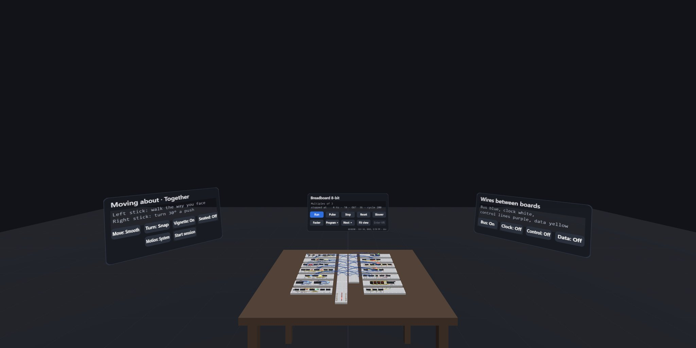

# Breadboard 8-bit

An interactive browser simulator that follows Ben Eater's YouTube playlist
[**Building an 8-bit breadboard computer!**](https://www.youtube.com/playlist?list=PLowKtXNTBypGqImE405J2565dvjafglHU)
video by video.

* **The finished computer** (`#/`): the SAP-1-style machine as it stands at the end of
  the series. It has 16 bytes of RAM, A/B registers, an adder/subtractor ALU with carry
  and zero flags, a microcoded control unit and a decimal display. You can pulse the
  clock by hand or let it run, and watch every control signal and bus transfer. It
  also has an assembler with Ben's programs, a live microcode table you can edit, and a
  microcode-version picker that matches the stage of the series.
* **Breadboard view** (`#/breadboard`): the same computer laid out as Ben's BB830 boards. It
  has 49 chips with his reference designators, 88 LEDs, the decimal display and every wire. The
  running simulation lights the LEDs, and the clock button, mode switches, DIP switches and reset
  work on the boards themselves. The boards are also real circuits: composed together and
  simulated chip by chip, they run Ben's 28 + 14 program and latch 42 (see
  `tests/boards-output-control.test.ts`).
* **Breadboard sandbox** (`#/sandbox`): an empty breadboard with Ben's parts bin (every 74LS chip
  in the build, the 28C16, the 555, LEDs, resistors, buttons, switches, DIP switches, 7-segment
  displays, and the 74LS85, 74LS90, 74LS92 and CD4511 from his digital clock). Wire up your own circuits and the chip-level engine simulates them. **Move** picks a
  part or a wire up and puts it elsewhere (click, then click a hole, or drag it), or just one end of
  a wire or a two-legged part when picked up by that end. **Step** (key S)
  pauses it and moves it on to the next change: a gate delay at a time while a change spreads
  through the gates, or on to the 555's next edge when nothing else is coming. It comes with
  seven example circuits, two of them from the digital clock (its ÷60 divider and its seconds), and **Share link** puts your circuit in a link (`#/sandbox/c1.…`) that
  opens it in anyone's sandbox. **View in VR** shows it in the VR view. See
  [docs/BREADBOARD.md](docs/BREADBOARD.md).
* **VR view** (`vr.html`): the breadboard computer in 3D on a table, run live by the simulator,
  with a control panel behind it (Run/Stop, Pulse, Step, Reset, speed, program). The switches,
  buttons and pot on the boards work too, as in the breadboard view: the clock's step button,
  manual/auto and speed pot, the address and data DIP switches, write, program/run, signed and
  reset. In a WebXR headset (Quest Browser, or Chrome/Edge with a PC headset) press **Enter VR**,
  point and pull the trigger (twist the controller to turn the pot); the grip buttons pick the
  computer up, and pulling both grips apart makes it bigger (up to 8x). The sticks move you about
  the room as in the Hallway: the left one walks the way you face (or, with **Move: Teleport**,
  aims a jump at the floor for when you let go), the right one turns 30° a push (or, with **Turn:
  Smooth**, while held), and the trigger at the floor jumps there; each jump blinks the view. The
  room's own panel, left of the table, sets **Move** and **Turn**, kept in the browser as the
  Hallway keeps them (`hallway.nav`, read and written by `common/nav.js`), so the choice is the
  same on both sides of its doors (`src/vr/move.ts`). On a screen, drag to look
  around, double-click to look closer, and click. It is built with three.js from the same layout
  as the breadboard view (`src/vr/`), at 1.5x real size. It also shows sandbox circuits:
  `vr.html#c1.…` (the code from a share link, or the sandbox's **View in VR**) or
  `vr.html#example/<id>`, run by the sandbox's chip-level engine. **Next ▸** on the panel goes
  through the computer and the seven examples.
  In VR the speed pot changes the speed evenly, tenfold per ~100° of twist (Ben's linear pot
  crowds 7–480 Hz into its first tenth). `vr.html?debug` logs to the console what the
  controllers do and, once a second, how evenly the frames come, to read from a headset over
  adb (`chrome://inspect`). On the dev server, `vr.html?xr=emulate` emulates a Quest 3 with
  Meta's [IWER](https://github.com/meta-quest/immersive-web-emulation-runtime), to try VR without
  a headset (a build leaves it out).
  The view is also behind a door of the [Hallway](https://ariamokr.github.io/hallway/), a WebXR
  corridor whose doors lead to other places. Its link (`vr.html?from=hallway&back=…`) puts
  **← Hallway** on the page's bar and in the corner of the panel, back to that door, for the rest
  of the visit; what the door added is taken off the address. Walking in from the Hallway's VR,
  a session that Quest Browser grants is taken at once, so the visitor stays in VR. A link from
  another hall that names itself (`backname`) shows that name on the way back instead of its
  host. This door contract is the one the places behind the Hallway's doors share:
  [AriaMoKr/common](https://github.com/AriaMoKr/common)'s `door.js` and `nav.js`, a dependency at a
  tag, with breadboard's own part (its door id, the doorway kept for the tab) in
  `src/vr/hallway.ts`. The Hallway's doorway shows the room through
  `public/hallway-preview.jpg`, the view from eye height 1.2 m behind the start, framed as the
  Hallway hangs a door's picture (`npm run preview-image` renders it again after the room
  changes). The visitor arrives there, as far to the side and turned as they went through, and
  behind them stands the door back: a doorway glowing in the door's colour, with the Hallway seen
  through it as the Hallway publishes the view from its door to here (its `views/views.json`,
  hung with the Hallway's own doorway shader, common's `portal.js`: `src/vr/door.ts`). Pointing at
  it, clicking it or stepping back through it leads back. On a screen the view starts where the
  doorway showed the room from, then glides to the table.
  **Together**: **Start session** on the room's panel (or, on a screen, **Start shared session**
  on the page's bar) shares the room through the Hallway's shared session
  ([layersharedsession](https://github.com/AriaMoKr/layersharedsession): peer to peer over
  WebRTC, finding the others through public Nostr relays; nothing connects until a session
  starts). Its address (`vr.html?room=…`) is the invitation (**Copy invite link**). Everyone in
  it sees the others who are here as a head with a visor, their hands in VR, a ring on the floor
  and their name, and the status says how many are here and elsewhere (in the Hallway, or behind
  another of its doors). A visitor who comes through the Hallway's door in a session stays in it,
  and the way back carries it on (`src/vr/together.ts`; the avatars are the layer's own, as on
  the other sites).
  [](https://ariamokr.github.io/breadboard/vr.html)
* **Chapter labs** (`#/lab/<id>`): each of the 44 videos maps to an interactive lab
  that rebuilds what that video builds. Examples: the 555 timer modes, SR/D latches,
  flip-flops, JK racing, tri-state buses, registers, two's complement, the ALU, RAM,
  counters, 7-segment and EEPROM decoders, the Arduino EEPROM programmer, the
  multiplexed decimal display, the control logic, microcode, flags and conditional jumps.
* **From semiconductors to logic gates** (`#/lab/transistor-gates`): a lab for Ben's three 2015 background
  videos. It shows charge carriers in doped silicon, and a PN junction you can bias forward or in
  reverse. It shows an NPN transistor with its thin base turning on, and his buffer, inverter, AND,
  OR and five-transistor XOR built from transistors, each with its current path and truth table.
* **Digital clock labs** (`#/lab/mains-60hz` …): a lab for each part of Ben's breadboard clock
  series published so far. They cover:
  * the 5 V supply and squaring the 60 Hz from the mains with an LM339 and hysteresis;
  * the edge detector and ramp that make the square wave independent of the input;
  * dividing by 60 with the 74LS90 and 74LS92;
  * the seconds and minutes with CD4511 decoders;
  * setting the time through an XOR gate, with switch bounce and its debounce.

  The analog parts are small time-step models with Ben's component values (`src/labs/dclock/_analog.ts`).
  The counters are the sandbox's chip models.
* **More videos** (`#/more`): Ben's videos outside the playlist that go with it. These are his first
  build running programs and his introduction to transistors and logic gates (both from 2015 and
  linked from eater.net/8bit), plus his digital clock series (2026, eater.net/clock).

## Running

It needs Node 22.12 or newer.

```bash
npm install
```

```bash
npm run dev
```

Then open http://localhost:5173. Other scripts: `npm test` (vitest), `npm run typecheck`,
`npm run build` (static site in `dist/`, see [Deploying](#deploying)), `npm run icons` (renders
the app icons from `public/icons/icon.svg`), `npm run preview-image` (renders the pictures that
show the site elsewhere: `public/social-preview.jpg`, the breadboard view close up, and
`public/hallway-preview.jpg`, the VR room for the Hallway's door; see [Link previews](#link-previews)).

Vite stays on version 7 for now. Vite 8's bundler, Rolldown, has no native build for the
MinGW-built Node in MSYS2's UCRT64 shell, so Vite 8 doesn't start there.

`npm run check:browser` checks in headless Chrome what the unit tests can't see. It checks
that every page renders without errors, that phones get no sideways scrolling and controls of
at least 24 px, the sticky toolbar, parts drawer and tap-to-zoom, the shared computer, placing,
moving, deleting and stepping in the sandbox with real clicks, taps and drags, sandbox links, the
breadboard view's frame rate, and that the VR view builds the computer in 3D, runs it, and
leads back to the Hallway when a door of it led there.
`npm run check:browser -- --dist`
checks the built site instead (run `npm run build` first), plus the download link, install and
offline use, and `-- --url <address>` checks a deployed copy the same way (such as
`https://example.com/breadboard/` after a deploy). It needs an installed Chrome, Edge or
Chromium (or `CHROME_PATH`).

`npm run check:input` takes a few minutes, so `verify` leaves it out: run it after changing
controls or layout. On every page, on a desktop with a mouse and on a phone with touch, it
clicks or taps controls the way a person does. Chrome then decides where each click goes, which
an event sent straight to the control skips. It checks that each control's own handler runs, so
nothing on top, no pointer captured elsewhere and no layout change between press and release
takes the click. It also checks that no control moves back and forth while the computer runs,
where a tap would land on whatever moved under the finger. `-- --page <text>` checks only the
pages whose route contains it, and `-- --url <address>` checks a deployed copy.

`npm run verify` runs the unit tests, the build and the browser checks on the built site, in that
order, stopping at the first failure. Run it before committing or pushing (it takes about two
minutes).

Keyboard on the computer page: **Space** = clock pulse, **I** = step one
instruction, **R** = run/stop, **Backspace** = reset.

## Deploying

`npm run build` writes a static site to `dist/`:
* `index.html` and `vr.html`, each with one JS and one CSS file. These are two builds, so the
  app doesn't carry three.js;
* the app manifest, icons and `sw.js` (a service worker, made by `scripts/sw-dist.mjs`);
* `breadboard-8bit.zip`, the same site as a download (made by `scripts/zip-dist.mjs`). It is
  reproducible: its files are dated with the last commit (or `SOURCE_DATE_EPOCH`), so the same
  site always makes the same zip.

Copy `dist/` to any static host, at the root or in a sub-folder. Pages use `#/…` URLs, so the
host needs no rewrite rules. A build rewrites every file, so with rsync compare by content
(`-c`), and leave out folder times (`-O`); then only what changed is listed and sent:

```bash
rsync -avcO --delete dist/ user@host:path/to/breadboard/
```

The sidebar offers the zip ("Download for offline use") wherever it sits next to `index.html`,
so not on the dev server or in a copy.

On GitHub, `.github/workflows/pages.yml` publishes the site to GitHub Pages on every push to
`main`. It runs the unit tests and `npm run build` on Linux, then deploys `dist/`, which comes out
the same as a build on Windows. To turn it on, set the repository's **Settings → Pages → Build
and deployment → Source** to **GitHub Actions** once. The site is then at
`https://<user>.github.io/<repo>/`, and the Actions tab can also run the workflow by hand.

Served over HTTPS, the site is an installable app: "Install" in desktop Chrome or Edge, or "Add
to Home Screen" on a phone. After the first visit it works offline, the VR view too. The service
worker keeps the pages fresh while online, so a new build shows up on the next visit. WebXR (the
VR view's "Enter VR") also needs HTTPS.

Each page is built as a single JS file on purpose, so a plain mirror gets all of it (a link in
`index.html`'s `<noscript>` leads wget to `vr.html`):

```bash
wget --mirror --no-parent --page-requisites https://example.com/breadboard/
```

Or download the zip:

```bash
curl -LO https://example.com/breadboard/breadboard-8bit.zip
```

Either copy has to be served over HTTP, because browsers don't run module scripts from
`file://`. In the folder with `index.html`:

```bash
python -m http.server 8000
```

Then open http://localhost:8000/.

### Link previews

`index.html` and `vr.html` carry Open Graph and X/Twitter tags, so a shared link shows a title,
the page's description and a picture: `public/social-preview.jpg` (1280 × 640) for the site and
`public/hallway-preview.jpg` (2048 × 1024) for the VR view. Link previews need absolute URLs, so
these tags name the GitHub Pages copy, wherever the site is served from;
`tests/link-preview.test.ts` checks them against each page and its picture. The pages don't show
the pictures, so the zip and the offline cache leave them out. `public/social-preview.jpg` is also the repository's social preview on GitHub (**Settings →
General → Social preview**, uploaded by hand: upload it again after `npm run preview-image`
changes it).

## How it's built

| Layer | Path | Notes |
| --- | --- | --- |
| Computer model | `src/sim/` | Control-signal-level, cycle-exact model. Registers latch on the rising edge from pre-edge bus values. The step counter advances on the falling edge (74LS161 on ~CLK) and resets at T5. HLT gates the clock. Undriven bus lines read 0 (10 kΩ pull-downs). IO drives only the operand nibble. Flags latch only on FI. Reset clears A, B, IR, MAR, flags, PC, OUT and the step counter. |
| Microcode | `src/sim/microcode.ts` | Verbatim from Ben's `microcode-eeprom-with-flags.ino`, with the same EEPROM address layout (`ZF CF │ byte-sel │ opcode │ step`) and four historical versions (control logic part 3 → Arduino → more instructions → flags). |
| Display | `src/sim/display.ts` | The `multiplexed-display.ino` EEPROM image: unsigned and two's complement, no leading-zero blanking. |
| Gate-level engine | `src/logic/circuit.ts` | Event-driven with unit gate delays, 0/1/Z/X levels, tri-state buffers and RC edge detectors, so latches, races and contention behave as in the videos. |
| UI | `src/ui/` | Framework-free widgets (LEDs, DIP switches, 7-segment, scope), live SVG schematics, the breadboard view of the computer. |
| Labs | `src/labs/**.lab.ts` | One file per lab, discovered automatically. See [docs/LABS.md](docs/LABS.md). |

Research notes with sources, used for fidelity:
[docs/research/computer-spec.md](docs/research/computer-spec.md) (exact behaviour of the
final machine), [docs/research/videos.md](docs/research/videos.md) (per-video content) and
[docs/research/clock.md](docs/research/clock.md) (the digital clock series) and
[docs/research/background.md](docs/research/background.md) (the transistor and gates videos).

## Credits

Ben Eater designed the computer, its microcode and the display code. See
[eater.net/8bit](https://eater.net/8bit) and
[beneater/eeprom-programmer](https://github.com/beneater/eeprom-programmer) (MIT).
This project is an independent, unofficial learning companion; watch the videos!

## License

[MIT](LICENSE).
